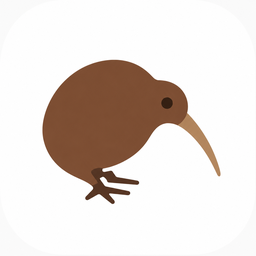

<p align="center"></p>

# Kiwi


Privacy-first web browser powered by the [Mustela](https://github.com/mel0k1/Mustela) engine. The mascot is a kiwi bird: small, curious, and very private about its burrow.

Русская версия: [README.ru.md](README.ru.md)

## What is Kiwi

Kiwi is the browser product built on top of the Mustela engine. The split is strict:

- **Mustela** owns the engine work — WebKit embedding, privacy policy, settings, profiles, history storage, performance.
- **Kiwi** owns the product — the full UI, privacy center, history and downloads screens, packaging, everything a user touches.

Kiwi consumes Mustela through its public API only. No WebKit types above the engine boundary, ever.

## Status

Kiwi 0.12.0. The build is now split per platform:

- **Linux** — the original GTK shell over the [Mustela](https://github.com/mel0k1/Mustela) engine's view library (`mustela_view_gtk`, WebKitGTK): the full product — privacy center, bookmarks manager, search engines editor, profiles, find bar, devtools, MHTML save, notifications — with zero WebKit types above the engine boundary.
- **Windows** — a native Win32 shell on CEF (Chromium, pinned per release). The engine's WinCairo view port is retired: it was the root cause of the whole 0.8.0–0.10.0 crash-and-workaround pile (white pages, use-after-free on the second tab, mingw cross-compilation, no sandbox, no codecs). Instead Kiwi-CEF links **mustela-core** — the engine's platform-agnostic core (settings pipeline, privacy policy, `resolve_entry` search, tracker blocklist, fingerprint scripts, bookmarks, profiles) — fetched as a library from the Mustela repo, and adds the CEF request/render layers for the privacy surface (third-party cookie filtering, WebGL/canvas/referrer/GPC scripts, font and ping blocking, DoH). The start page, the omnibox pipeline and the settings file are shared with the Linux build. Full mapping and honest gaps: [docs/CEF_PARITY.md](docs/CEF_PARITY.md).

- **K1 first flight (0.1.0)** — tabbed shell, engine-driven address bar, privacy toggle, history and downloads screens.
- **K2 privacy center (0.2.0)** — per-site override editor with a live toolbar indicator, stored-data scan/clear screens, Material Design 3 peach theme.
- **K3 library and settings (0.3.0)** — bookmarks manager (Ctrl+D star in the address bar, Ctrl+Shift+O manager), search engines editor (`!keyword` shortcuts, default engine), profile manager (per-profile data roots, restart-safe switching).
- **View slice 2 UI (0.4.0)** — find-in-page bar over the engine's find controller (Ctrl+F, F3/Shift+F3, Esc closes, live hit/miss hint), an MD3 context menu (open link/image in a new tab, copy addresses, edit commands, "Search with …" over the default engine through the engine's selection bridge, inspect element), and a devtools toggle (Ctrl+Shift+I) docking the engine's inspector.
- **Packaging and updates (0.5.0)** — a "Check for updates" button in Settings → About & updates: a strictly manual check against GitHub Releases (no background traffic), a platform asset picker, semver comparison, release notes and a download into the Downloads directory; a deb with install rules (icon, `.desktop`, AppStream metainfo, shlib-deps), a Flatpak manifest on the GNOME 48 runtime, and a tag-triggered release job that attaches both to the GitHub Release the updater reads. Windows stays an honest gap: MSYS2 removed the WebKitGTK packages, so there is no maintained Windows runtime to package against yet.
- **Identity and platform dressing (0.6.0)** — the K5 milestone: a full freedesktop hicolor icon set generated from the mascot artwork (`scripts/make_icons.py`, 16–256 px), a Material-Design-3 pastel-peach project website deployed to GitHub Pages (`site/`, deployed by the `site` workflow), the AppStream homepage pointing at it, and the engine view slice 3 surfaced in the UI: page saving as MHTML (Ctrl+S, native save dialog, suggested name from the page title, status-bar confirmation), HTML5 element fullscreen requests fullscreen the Kiwi window (F11 toggles it manually), and web notifications render through `GNotification` on a registered `GApplication` (dropped quietly when no session bus exists).
- **Windows port (0.8.0)** — Kiwi builds and runs on Windows for the first time: the chrome stays GTK3 (MSYS2 MinGW-w64), every web view comes from the engine's Windows view library (`mustela_view_win` over the WinCairo WebKit C API), and a CI job builds engine + browser, runs the updater tests, assembles a portable zip (WebKit runtime, GTK runtime, pixbuf loaders, launcher) and smoke-launches it. The native `HWND` view is hosted inside the GTK window by a small view-host layer (`src/viewhost*.cpp`) with geometry sync plus a keyboard hook that keeps the shortcut set alive while a web view holds focus.
- **Installer and Windows engine lifts (0.9.0)** — a tag-triggered Inno Setup build produces `kiwi-setup-x64.exe` (per-user install into `%LocalAppData%\Programs\Kiwi`, Start-menu + optional desktop shortcuts, uninstaller; user data survives uninstall) next to the portable zip, and `kiwi.exe` configures its relocatable gdk-pixbuf loader cache before GTK init so shortcuts can launch the exe directly — the updater already prefers the installer over the zip on Windows. The engine bump to Mustela v0.25.0 lifts the 0.8.0 no-ops on Windows: the MD3 context menu's edit commands run through `WKPageExecuteCommand`, Ctrl+S saves MHTML, devtools open through `WKInspector`, notification permission decisions follow the site-rule policy and provider forwarding, and the hosted view applies the monitor's DPI backing scale. Still honest on Windows: no toast presentation for notifications yet (the engine forwards them to the embedder), the portable zip stays portable-experimental until a manual pass on real hardware.
- **Windows usability pass (0.10.0)** — the first-feedback fixes: the portable zip and installer now ship the WebKit helper processes (`WebProcess.exe`, `NetworkProcess.exe`) whose absence made every page render as a white window with a dead address bar; the view-host layer keeps page records at stable addresses (a vector reallocation on the second tab turned every earlier tab's GTK handlers into use-after-free crashes); closing a tab parks the `View` on an idle source so it is never destroyed inside a WebKit callback (`window.close()`, close during a load); the engine (Mustela v0.25.1) always resolves the JS `prompt()` listener and owns popup creation before the embedder callback. The shell gained a real start page (`kiwi://start` — search card over the default engine, bookmark tiles with favicons, clock, private banner, written into the profile and served over `file://`), a permanently visible tab strip, and cairo-drawn MD3 toolbar icons that no longer depend on an icon theme (GTK ships Windows without one — that is where the "icons from the past" came from). Diagnostics land in `%LocalAppData%\kiwi` (`crash.log` + minidump via an unhandled-exception filter, `kiwi.log` for GTK criticals), and CI now runs a scripted `--self-test` pass (open/switch/close tabs, start page, omnibox, resize) on real Windows and Linux instead of a passive launch.
- **CEF transition (0.11.0)** — Windows moves from the WebKit WinCairo port to CEF (Chromium 152, pinned + sha1-checked in CI): a native Win32 shell (tab strip, omnibox over `resolve_entry`, GDI-drawn glyphs, start page, private tabs over an incognito request context) on top of **mustela-core** fetched as a static library from the Mustela repo; the mingw/GTK-on-Windows pipeline and its workaround pile are retired. Linux is untouched. The parity matrix and the deliberate cuts live in `docs/CEF_PARITY.md`.
- **CEF polish (0.12.0)** — the Windows shell catches up with the 0.4.0 GTK feature set: find-in-page over `CefFindHandler` (Ctrl+F opens the bar, typing searches live, Enter/F3 and Shift+F3 step through matches, Esc closes, a "n of m" counter reports the hit count per tab), a devtools toggle (Ctrl+Shift+I) that opens the inspector in its own CEF popup window via `ShowDevTools`/`CloseDevTools` (a dedicated client keeps the DevTools browser out of the tab strip), and per-tab close buttons — the tab strip is owner-drawn now (selected tab highlighted, hover feedback, MD3 peach palette) with a hover-highlighted × in every tab that closes it without switching selection. Closing the last tab now closes the browser instead of leaving an empty shell.

Build:

```bash
git clone https://github.com/mel0k1/Mustela.git ../Mustela
cmake -S ../Mustela -B ../Mustela/build -DCMAKE_BUILD_TYPE=Release
cmake --build ../Mustela/build
cmake -S . -B build -DCMAKE_BUILD_TYPE=Release
cmake --build build
./build/kiwi
```

Windows (Visual Studio, any recent version; the CI `windows` job runs exactly this pipeline and packs the zip + installer):

```powershell
$cef = "152.0.14+g8a0b5b9+chromium-152.0.7977.167"
Invoke-WebRequest -Uri ("https://cef-builds.spotifycdn.com/" +
  [uri]::EscapeDataString("cef_binary_$cef" + "_windows64_minimal.tar.bz2")) -OutFile cef.tar.bz2
tar -xf cef.tar.bz2
Move-Item "cef_binary_*_windows64_minimal" cef-dist
cmake -S . -B build -A x64 -DKIWI_WITH_CEF=ON -DCEF_ROOT="$PWD/cef-dist"
cmake --build build --config Release
ctest --test-dir build -C Release --output-on-failure
./build/Release/kiwi.exe
```

mustela-core is fetched automatically from the Mustela repo (pinned `v0.25.1`) during configure.

## Ecosystem

| Project | Role |
|---------|------|
| [Mustela](https://github.com/mel0k1/Mustela) | Engine: WebKit view for Linux, mustela-core privacy/settings library for every platform |
| Kiwi | Browser UI on top of Mustela |

## Roadmap

See [docs/ROADMAP.md](docs/ROADMAP.md): K0 nesting, K1 first flight (UI shell on Mustela), K2 privacy center, K3 library and settings, K4 packaging, K5 identity, then the CEF transition (0.11.0) and the C2–C6 series.

## License

Kiwi is licensed under the [GNU LGPL-2.1](LICENSE).
